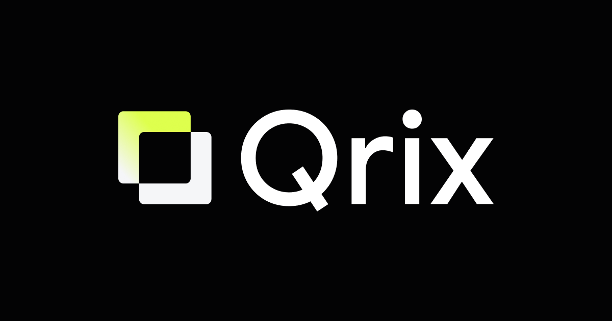

# Qrix

[](https://github.com/Maletskiy/qrix/actions/workflows/ci.yml) [](LICENSE)

A QR code generator for crypto payments, links, text, Wi-Fi and contact cards — with a design system that does not destroy scannability.

**“There is no square. There is code.”** — the QR code is formally a matrix of modules, even though we see a grid of squares. The name is a nod to that.

Everything runs **in the browser**: addresses, passwords and amounts never leave the device. No backend, no analytics, no network calls after the app loads.

> Live demo → **[qr-ix.com](https://qr-ix.com)**



---

## Why another QR generator

Existing services treat crypto as an afterthought: three coins, and the address plus amount are always squeezed into the same `address?amount=` shape. But payment request standards differ per chain — ignore them and the wallet either drops the amount or refuses to read the code at all.

Qrix builds payloads to spec:

| Network | Standard | What ends up in the code |
|---|---|---|
| Bitcoin, Litecoin, Dogecoin | BIP-21 | `bitcoin:<address>?amount=&label=&message=` |
| Ethereum | ERC-681 | `ethereum:<address>@1?value=<wei>` |
| Solana | Solana Pay | `solana:<address>?amount=&label=&message=` |
| TON | TON | `ton://transfer/<address>?amount=<nanotons>&text=` |
| USDT, USDC and other tokens | — | address only: the wallet resolves network and contract itself |

Amounts are converted to the smallest unit exactly, via `BigInt` — `0.015 BTC` never becomes `0.01499999` because of floating point.

## Features

**Content types**
- **15 coins and networks** with live address format validation (Bitcoin, Lightning, Ethereum, USDT TRC-20/ERC-20, Solana, TON, XRP, Dogecoin, Litecoin, BCH, ADA, Monero…)
- **Links**, **plain text** with Cyrillic and emoji
- **Wi-Fi** with standards-compliant escaping (SSID, password, WPA/WEP/open, hidden network)
- **E-mail** (recipient, subject, body) and **contact cards** (MECARD: name, phone, e-mail, company)
- **Phone input that behaves**: digits and a leading `+` only; Russian numbers are normalised to `+7 999 888 77 66`, while an explicit country code is respected — `+1 202 555 0147` stays itself. The QR gets the number without spaces.

**Styling**
- 6 module shapes (rounded, square, dots, heart, diamond, star), 4 marker frames, 6 marker cores — all with icons and tooltips
- Solid fill or gradient in 5 directions (vertical, horizontal, two diagonals, radial)
- 8 ready-made gradient presets, square swatches
- Logo in the centre — modules **under the logo are cut out**, not covered, so a clean quiet gap stays around it. Change size, padding or radius and the cut-out area is recalculated, with the module pattern rebuilt around it. An SVG logo is inlined as real vector paths, so it survives the exported file being opened in Figma or Illustrator
- Optional caption under the code (text, font, colour) — placed outside the symbol's quiet zone, so per the standard it does not affect scanning. With the bundled font the caption is **converted to outlines**, so it stays a vector in Figma or Illustrator instead of turning into a substituted font

**Colour**
- Custom colour picker instead of the unstyled native browser dialog: saturation field, hue slider, 24 ready colours, and a HEX input. Closes on outside click and on `Escape`

**Export**
- PNG at exactly the resolution you pick, SVG, and copy-to-clipboard for both — plus copying the raw payload
- In SVG the whole code is **a single vector**: modules, marker frames and cores are merged into one `<path>` with `fill-rule="nonzero"`, where inner contours run counter-clockwise to punch the holes. In Figma or Illustrator it is one object, not a hundred layers

**Usability**
- Live address validation, contrast warnings, oversized-logo and margin warnings, decorative-shape warnings, and a panel showing exactly what is encoded
- Shareable pre-filled links (state lives in the URL, see below)
- 5 languages: English, Russian, French, German, Spanish — switchable in the header, remembered in `localStorage`, or forced with `?lang=xx`
- Mobile-first layout: the QR preview sits between the content block and the style settings, collapsible sections, a bottom bar with actions and a mini preview that scrolls you back to the code, and a swipe-to-dismiss coin picker

## Quick start

Requires **Node.js 18+**.

```bash
git clone https://github.com/Maletskiy/qrix.git
cd qrix
npm install
npm run dev        # dev server on http://localhost:5173
```

Other commands:

```bash
npm run build      # production build into dist/
npm run preview    # serve the build locally
npm run verify     # readability test: render + decode every style
```

## Install with an AI agent

Qrix is small, self-contained and has no backend, which makes it a good thing to clone and run through a coding agent. Paste one of these into Claude Code, Cursor, Codex, Windsurf or any agent with shell access.

**Just run it**

```text
Clone https://github.com/Maletskiy/qrix into a new folder, run npm install,
then start the dev server with `npm run dev` and tell me the local URL.
Do not change any source files.
```

**Run it and verify the build**

```text
Clone https://github.com/Maletskiy/qrix, install dependencies, run
`npm run verify` to check QR readability, then `npm run build`.
Report any failing checks and the bundle size.
```

**Deploy it to my Vercel account**

```text
Clone https://github.com/Maletskiy/qrix, install dependencies, and deploy it
to Vercel as a production build. It is a static Vite app, so no server is
needed. Give me the production URL and keep .vercel and any tokens out of git.
```

**Make it yours**

```text
Clone https://github.com/Maletskiy/qrix. Replace the branding: the wordmark
in the header, the logo at public/qrix-logo.svg, and the og:image at
public/og.png. Keep the QR rendering logic in src/lib/render.ts untouched,
then run `npm run verify` to make sure the codes still decode.
```

> Tip: ask the agent to run `npm run verify` after any change to styling or rendering. It renders real codes and decodes them with `jsqr`, which catches the “looks nice, scans badly” class of bug.

## Deploy your own

The build is fully static, so any static host works: Vercel, Netlify, Cloudflare Pages, GitHub Pages, an S3 bucket, nginx.

**Vercel CLI**

```bash
npm i -g vercel
vercel --prod
```

The Vite preset is detected automatically — accept the defaults. `dist/` is ignored by git and built in the cloud.

**Generic static hosting**

```bash
npm run build
# then upload the contents of dist/
```

The app uses `base: "./"`, so it also works from a subdirectory.

## Readability, not just looks

A beautiful QR code is useless if a scanner cannot read it. The repo ships a test that builds codes in every style, rasterises them and **decodes** them (`@resvg/resvg-js` to render, `jsqr` to recognise):

```bash
npm run verify
```

What the test established:

| Observation | Decision |
|---|---|
| Round dots stop decoding when the radius drops below 0.5 | Dots are drawn touching: `r = 0.5`. The size slider lets you go down to 0.98 — below that jsQR fails on medium and long codes, so the UI warns |
| Shrinking dots breaks decoding sooner than expected: 0.96 already fails | Safe threshold is `DOTS_SAFE_SCALE = 0.98`, below it the UI warns |
| Hearts only read when enlarged | Shape scale is set to 1.18 automatically |
| Diamond and star lose too much dark module area and never pass | Kept as decorative options with an explicit warning |
| A diamond marker frame breaks code location | Flagged as risky |
| Separating gaps on short links (under 30 characters) confuse the decoder | The app warns; the test checks medium and long codes |

Short links plus decorative shapes are a known limitation: the decoder loses the module grid. Instead of hiding that, the interface warns you the moment you pick such a combination.

## Shareable state

The app reads its state from the URL, so a pre-filled code can be shared:

```
?type=crypto&coin=btc&address=<address>&amount=0.015&label=Payment
```

Supported keys: `type`, `coin`, `address`, `amount`, `label`, `message`, `link`, `text`, `ssid`, `password`, plus `lang`.

## How it works

```
src/
  lib/
    qr.ts        encoding wrapper (qrcode-generator, UTF-8 mode)
    render.ts    the SVG renderer: single path, marker shapes, logo cut-out, caption
    payload.ts   content type → standards-compliant payload
    coins.ts     15 coins: symbol, network, URI scheme, hints
    config.ts    config shape, defaults, palettes, URL state
    styles.ts    shape options, safe-scale thresholds, risk hints
    phone.ts     phone mask and normalisation
    color.ts     HEX ⇄ RGB ⇄ HSV
    export.ts    PNG rasterisation, SVG download, clipboard
    i18n/        five typed dictionaries
  components/    panels, preview, colour picker, coin sheet, UI primitives
```

- **Vite + React + TypeScript**, no state library — a plain config object flows down
- Encoding via `qrcode-generator` with UTF-8 enabled, otherwise Cyrillic breaks
- All drawing is a custom SVG renderer: it merges modules into one path with radii only on free corners, so neighbouring modules visually join while markers and logo stay separate
- Every dictionary is typed against the Russian one being the source of truth: a missing key breaks the build instead of rendering an empty string

## Known limitations

- Diamond and star module shapes, and a diamond marker frame, do not decode — they are decorative, and the UI says so
- Codes shorter than 30 characters read unreliably with round dots and hearts
- Captions in the bundled font are outlined and stay vector; the Serif and Mono options use system fonts, so they fall back to `<text>` and may be substituted by the reader
- Safari may show its own paste prompt for the “Paste” buttons — that is system behaviour, not something a page can bypass

## Credits

- QR encoding — [`qrcode-generator`](https://github.com/kazuhikoarase/qrcode-generator) (MIT)
- Rasterising and decoding in tests — [`@resvg/resvg-js`](https://github.com/thx/resvg-js), [`jsqr`](https://github.com/cozmo/jsQR)
- Arrow icons — [Phosphor Icons](https://phosphoricons.com) (MIT)
- Coin logos — [`cryptocurrency-icons`](https://github.com/spothq/cryptocurrency-icons) (MIT) and the [emcd](https://emcd.io) icon set
- Typeface — Google Sans (loaded locally from `public/fonts/`)

## License

[MIT](LICENSE) — do whatever you want, attribution appreciated.

---

Made by [Maletskiy Design](https://maletskiy-design.ru) · [Русская версия README](README.ru.md)
